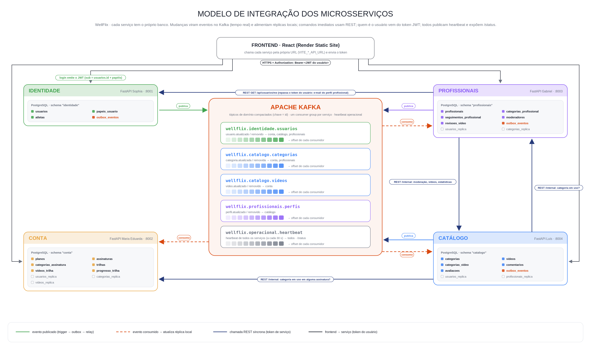

# Integração entre microsserviços

O WellFlix tem quatro microsserviços FastAPI. **Cada um é dono do próprio banco** (um schema PostgreSQL exclusivo) e nenhum lê ou grava tabelas de outro. Eles se integram por três meios:

| Meio | Quando é usado | Exemplo |
|---|---|---|
| **Token JWT** | Saber quem é o usuário e quais papéis tem | O login na identidade emite o token; os outros serviços só validam a assinatura |
| **Eventos no Kafka** (assíncrono, tempo real) | Dados que outro serviço lê com frequência | Nome de usuários, categorias, situação dos vídeos, categorias autorizadas de um profissional |
| **REST** (síncrono) | Comandos que precisam de resposta imediata e consultas agregadas | Moderar ou arquivar um vídeo, checar se uma categoria está em uso, estatísticas de um profissional |

## Quem é dono de quê

| Serviço (schema) | Tabelas próprias | Réplicas (via Kafka) |
|---|---|---|
| **identidade** | usuarios, papeis_usuario, atletas | — |
| **catalogo** | categorias, videos, categorias_video, comentarios, avaliacoes | usuarios_replica, profissionais_replica |
| **profissionais** | profissionais, categorias_profissional, seguimentos_profissional, moderadores, revisoes_video | usuarios_replica, categorias_replica |
| **conta** | planos, assinaturas, categorias_assinatura, trilhas, videos_trilha, progresso_trilha | usuarios_replica, categorias_replica, videos_replica |

Os serviços que publicam eventos também têm a tabela `outbox_eventos`.

Uma coluna que aponta para outro serviço (por exemplo, `trilhas.atleta_id` → identidade) é uma **referência lógica**: guarda o UUID, mas não tem `FOREIGN KEY`. Quem garante que o id é válido é a aplicação: o id vem do token, foi conferido numa réplica ou foi validado pela API do outro serviço.

## Eventos (Kafka)

**Fluxo de um evento.**
1. O dado muda (`INSERT`, `UPDATE` ou `DELETE`).
2. Um trigger grava o evento em `outbox_eventos` **na mesma transação** e avisa com `pg_notify('outbox')`.
3. O *relay* (uma thread do serviço) recebe o aviso e publica no Kafka na hora.
4. O consumidor de cada serviço interessado grava a réplica e só então confirma o offset.

| Tópico | Produtor | Eventos | Consumidores → réplica |
|---|---|---|---|
| `wellflix.identidade.usuarios` | identidade | `usuario.atualizado`, `usuario.removido` (id, nome, papéis) | catalogo, profissionais, conta → `usuarios_replica` |
| `wellflix.catalogo.categorias` | catalogo | `categoria.atualizada`, `categoria.removida` | profissionais, conta → `categorias_replica` |
| `wellflix.catalogo.videos` | catalogo | `video.atualizado`, `video.removido` (id, profissional, título, situação) | conta → `videos_replica` |
| `wellflix.profissionais.perfis` | profissionais | `perfil.atualizado`, `perfil.removido` (categorias autorizadas) | catalogo → `profissionais_replica` |

**Garantias.**
- **Nada se perde.** O evento é gravado junto com o dado (*transactional outbox*). Se o Kafka cair, os eventos esperam no outbox e são publicados quando ele voltar.
- **Processar duas vezes não estraga nada.** A entrega é "pelo menos uma vez" e o consumidor grava o estado completo com *upsert*.
- **A ordem é respeitada por entidade.** A chave da mensagem é o id da entidade, então eventos da mesma entidade chegam em ordem.
- **O Kafka guarda o último estado de cada entidade.** Os tópicos são compactados, então um serviço novo, ou um que ficou dormindo no Render, lê o tópico desde o começo e reconstrói as réplicas.
- **Dados sensíveis não saem da identidade.** E-mail, CPF e senha nunca vão para o Kafka. Quem precisa do e-mail (o perfil profissional) consulta `GET /api/usuarios/me` repassando o token do próprio usuário.
- **Mudanças feitas direto no SQL também viram evento.** Isso vale, por exemplo, para dar o papel de moderador pelo console, porque os triggers rodam em qualquer alteração.

## Chamadas REST entre serviços

As rotas `/internal/...` só aceitam um **token de serviço**. Esse token é assinado com o mesmo `AUTH_TOKEN_SECRET`, mas tem audiência própria e vale por 2 minutos. Um token de usuário não abre rota interna, e um token de serviço não serve como token de usuário.

| Quem chama | Quem responde | Rota | Para quê |
|---|---|---|---|
| profissionais | catalogo | `GET /internal/videos?situacao=` | fila de moderação |
| profissionais | catalogo | `POST /internal/videos/{id}/moderacao` | publicar/rejeitar (a revisão é gravada no banco de profissionais e desfeita se o catálogo recusar) |
| profissionais | catalogo | `POST /internal/videos/{id}/arquivamento` | arquivar vídeo |
| profissionais | catalogo | `GET /internal/profissionais/estatisticas`, `GET /internal/profissionais/{id}/videos` | quantidade de vídeos, avaliação média e vídeos publicados |
| profissionais | identidade | `GET /api/usuarios/me` (token do usuário) | e-mail no perfil profissional |
| catalogo | profissionais, conta | `GET /internal/categorias/{id}/uso` | impedir excluir categoria em uso |

## Observabilidade da integração

Todos os serviços usam o mesmo módulo operacional (`backend/services/shared/observabilidade.py`), equivalente ao *sidecar* do capítulo 17 de *Fundamentals of Software Architecture*:

- logs no formato `data | serviço | nível | componente | [req=id] mensagem`, com linhas `PUBLICADO`, `CONSUMIDO`, `REST` e `HEARTBEAT`;
- `X-Request-ID` propagado nas chamadas REST e gravado nos eventos (`outbox_eventos.correlacao`), o que permite seguir uma ação de um serviço a outro;
- heartbeat de cada serviço no tópico `wellflix.operacional.heartbeat` e `GET /status` com o último heartbeat recebido dos outros.

O modelo completo, as evidências de execução e a verificação do Render estão em [`docs/entregas/Modelo arquitetônico de integração.md`](../entregas/Modelo%20arquitet%C3%B4nico%20de%20integra%C3%A7%C3%A3o.md).

## Decisões do modelo

- **Um banco por serviço.** Cada serviço tem o próprio schema e só acessa ele; não há `JOIN` nem chave estrangeira entre bancos.
- **`videos.profissional_id`** é uma referência lógica ao perfil profissional, validada pela réplica `profissionais_replica` ao enviar o vídeo.
- **`revisoes_video.moderador_id`** é obrigatório e referencia `moderadores`, que fica no serviço de profissionais e moderação, junto com quem modera.
- **`CATEGORIAS` é do catálogo.** Conta e profissionais guardam só o id, a assinatura guarda também uma cópia do nome (`categoria_nome`) para o histórico, e os dois serviços recebem as categorias pela réplica.
- **Trilhas só aceitam vídeos publicados.** É conferido na réplica `videos_replica`. Como vídeos publicados não podem ser excluídos, nenhuma trilha fica apontando para um vídeo apagado, e não é preciso FK entre os bancos.

## Como rodar

Veja [`backend/services/README.md`](../../backend/services/README.md): `scripts/rodar_local.sh` sobe PostgreSQL e Kafka (`docker-compose.yml`), migra cada schema e inicia os quatro serviços com logs em `logs/`; `scripts/demo_integracao.py` exercita o fluxo entre eles.

Os diagramas são gerados por script em [`docs/banco_dados/diagrama/`](../banco_dados/diagrama/) e podem ser regenerados com `python docs/banco_dados/diagrama/gerar_diagrama_er.py` e `gerar_diagrama_integracao.py`.
