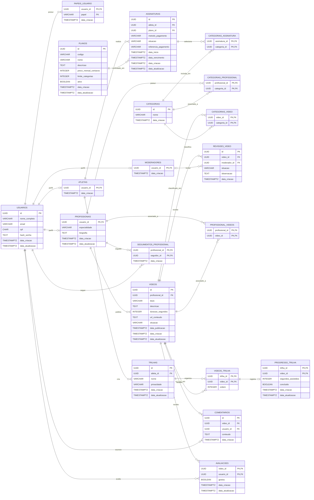

# Diagrama entidade-relacionamento

Este diagrama representa as tabelas e chaves estrangeiras criadas pelas migrations em `backend/src/db/migrations`. Os atributos marcados como `PK` são chaves primárias; `FK` identifica chaves estrangeiras. Nas tabelas associativas, a chave primária é composta pelas colunas marcadas.

## Como ler as ligações

Cada extremidade de uma ligação mostra quantas ocorrências daquela entidade podem estar relacionadas a uma ocorrência da entidade oposta:

| Símbolo | Significado |
| --- | --- |
| `o` | Participação opcional: zero ocorrências. |
| `|` | Uma ocorrência. |
| `{` | Muitas ocorrências. |
| `--` | Linha que conecta as entidades; o texto após ela nomeia a relação. |

Os símbolos nas extremidades são combinados:

| Combinação | Significado |
| --- | --- |
| `o|` | Zero ou uma (opcional, no máximo uma). |
| `||` | Exatamente uma (obrigatória). |
| `o{` | Zero ou muitas (opcional, pode haver várias). |
| `|{` | Uma ou muitas (obrigatória, pode haver várias). |

Por exemplo, `USUARIOS ||--o{ COMENTARIOS` indica que cada comentário pertence a exatamente um usuário, enquanto um usuário pode ter zero ou muitos comentários. Em `USUARIOS o|--o{ REVISOES_VIDEO`, uma revisão pode ter zero ou um usuário associado como moderador, e um usuário pode estar associado a zero ou muitas revisões.

**Observações**

- `videos.profissional_id` referencia `usuarios.id` diretamente. `profissional_videos` também relaciona `profissionais` e `videos` por uma tabela associativa; o diagrama mantém ambas as relações, conforme as FKs implementadas, sem presumir que sejam uma única relação.
- `revisoes_video.moderador_id` referencia `usuarios.id` e é anulável; a FK não exige que exista um registro correspondente em `moderadores`.
- `progresso_trilha` referencia a chave composta `(trilha_id, video_id)` de `videos_trilha`.
- `wellflix_schema_migrations`, criada pelo executor de migrations, foi omitida por ser uma tabela técnica de controle, não uma entidade do domínio.
