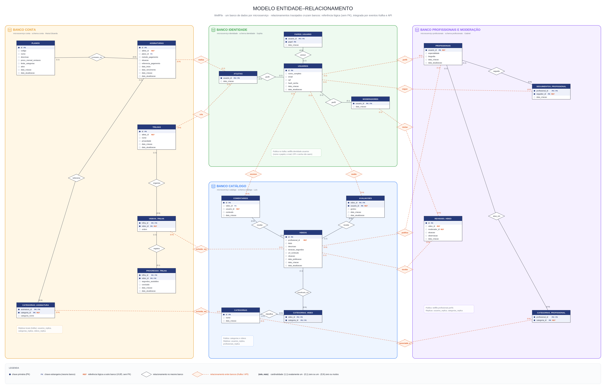

# Modelo de dados — Parte 1: usuários e perfis

**Apresentação:** Sophia · **Tabelas:** USUARIOS, PAPEIS_USUARIO, ATLETAS, PROFISSIONAIS, MODERADORES

## Ideia central

`USUARIOS` é a tabela "mãe" de qualquer pessoa no WellFlix. Uma pessoa tem **uma única conta** (nome, e-mail, CPF e senha) e pode ter um ou mais **papéis**: atleta, profissional e moderador.

- **PAPEIS_USUARIO** diz o que a pessoa **pode fazer**. É usada no login e vai dentro do token.
- **ATLETAS, PROFISSIONAIS e MODERADORES** são os **perfis**, uma especialização de USUARIOS. Guardam os dados de cada papel e são o alvo das referências das outras partes do modelo.

Os perfis **não têm id próprio**: a chave primária deles é o próprio `usuario_id`. Por isso uma pessoa tem, no máximo, um perfil de cada tipo.

## Tabelas e chaves

| Tabela | Chave primária | Chave estrangeira / referência | Observações |
|---|---|---|---|
| USUARIOS | `id` (UUID) | — | `email` e `cpf` são **únicos** (chaves candidatas) |
| PAPEIS_USUARIO | `(usuario_id, papel)` **composta** | `usuario_id` → USUARIOS.id | `papel` ∈ {atleta, profissional, moderador} |
| ATLETAS | `usuario_id` | `usuario_id` → USUARIOS.id | PK e FK ao mesmo tempo |
| MODERADORES | `usuario_id` | `usuario_id` → USUARIOS.id | PK e FK ao mesmo tempo |
| PROFISSIONAIS | `usuario_id` | referência lógica → USUARIOS.id | `especialidade`, `biografia` (fica no serviço de profissionais) |

> **A ligação é sempre pelo `usuarios.id`.** O CPF **não** liga tabelas: ele é único só para impedir cadastro duplicado. Não usamos o CPF como chave porque é um dado sensível e assim ele não se espalha pelas outras tabelas nem vai para o token.

## Relacionamentos (frases para a apresentação)

1. **USUARIOS — PAPEIS_USUARIO (1 : N, "possui").** "Um usuário possui de 0 a N papéis, e cada papel pertence a exatamente 1 usuário. A partir do `id` do usuário (chave primária), buscamos em PAPEIS_USUARIO as linhas com o mesmo `usuario_id` (chave estrangeira). A chave primária composta `(usuario_id, papel)` impede dar o mesmo papel duas vezes." PAPEIS_USUARIO é uma **entidade fraca**: só existe junto com o usuário.
2. **USUARIOS — ATLETAS (1 : 0..1, "é").** "Um usuário tem no máximo um perfil de atleta, e todo atleta é exatamente um usuário. `atletas.usuario_id` é chave primária e estrangeira ao mesmo tempo: por ser PK, não se repete."
3. **USUARIOS — MODERADORES (1 : 0..1, "é").** Mesmo raciocínio do atleta.
4. **USUARIOS — PROFISSIONAIS (1 : 0..1, "é").** "Nome, e-mail e CPF ficam em USUARIOS; em PROFISSIONAIS ficam só especialidade e biografia."

Essa especialização é **sobreposta**, porque a mesma pessoa pode ser atleta *e* profissional, e **parcial**, porque uma conta pode não ter perfil nenhum. Se a conta for apagada, `ON DELETE CASCADE` apaga também os papéis e os perfis.

## Como as outras partes dependem desta

Todas as outras partes guardam o `usuarios.id` (ou o id do perfil) para dizer **quem**:

- a trilha e a assinatura são de um **atleta**;
- o vídeo é de um **profissional**;
- o comentário, a avaliação e o seguimento são de um **usuário**;
- a revisão de vídeo é de um **moderador**.

## Onde isso mora agora (banco por serviço)

USUARIOS, PAPEIS_USUARIO, ATLETAS e MODERADORES ficam no schema **identidade**. PROFISSIONAIS fica no schema **profissionais**, porque é o serviço do Gabriel que cuida desse perfil.

**Entre serviços não existe chave estrangeira.** O `profissionais.usuario_id` é uma referência lógica, e os outros serviços sabem quem é o usuário de três jeitos:

- **Token JWT:** o login devolve um token com `sub = usuarios.id` e os papéis.
- **Kafka:** quando um usuário é criado, muda de nome ou ganha um papel, um *trigger* grava um evento e ele é publicado no tópico `wellflix.identidade.usuarios`. Os outros serviços guardam uma cópia (`usuarios_replica`) só com id, nome e papéis. **E-mail, CPF e senha nunca saem do serviço de identidade.**
- **API:** quem precisa do e-mail consulta `GET /api/usuarios/me` com o token do próprio usuário.

## No código (`backend/services/identidade/main.py`)

| Rota | O que faz no banco |
|---|---|
| `POST /api/atletas` | Em uma única transação, faz `INSERT` em usuarios, em papeis_usuario (`'atleta'`) e em atletas com o mesmo id. E-mail ou CPF repetido viola o índice único e a API responde `409`. |
| `POST /api/auth/sessao` | Faz `usuarios JOIN papeis_usuario ON p.usuario_id = u.id`, confere a senha e emite o token com o id e os papéis. |
| `GET /api/atletas/me` | Faz `usuarios JOIN atletas`. O CPF volta mascarado. |
| `GET /api/usuarios/me` | Devolve a conta e os papéis (subconsulta em papeis_usuario). |
| `PUT /api/atletas/me/perfil` | Atualiza nome e e-mail só se a conta for atleta. O trigger publica o novo nome no Kafka. |

## Perguntas prováveis

- **Por que não usar o CPF como chave primária?** Porque é um dado sensível e pode precisar de correção. O UUID não expõe nada. O CPF continua único (chave candidata).
- **Qual a diferença entre PAPEIS_USUARIO e as tabelas de perfil?** A primeira dá a **permissão** (vai no token). As de perfil guardam os **dados** do papel.
- **Uma pessoa pode ser atleta e profissional?** Pode. Ela tem duas linhas em PAPEIS_USUARIO e uma linha em cada perfil, todas com o mesmo `usuario_id`.
- **Como o catálogo mostra o nome de quem comentou, se não pode ler o banco da identidade?** Pela `usuarios_replica` dele, que o Kafka mantém atualizada em tempo real.

