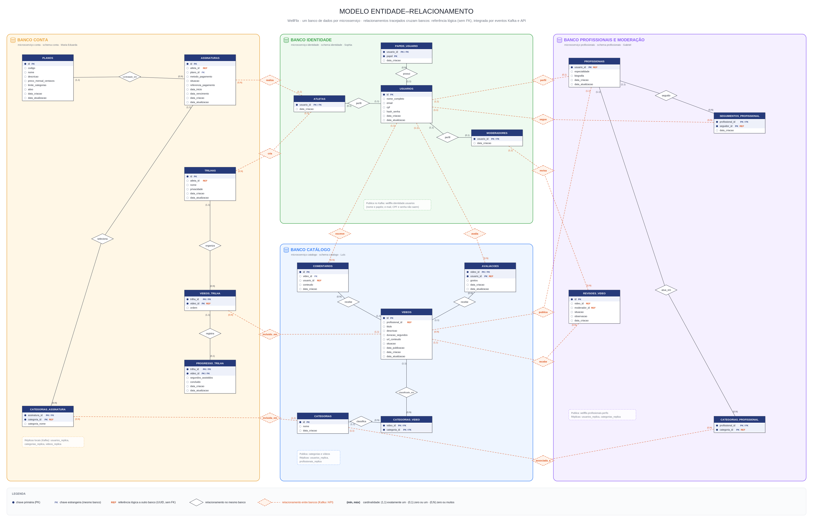

# Modelo de dados — Parte 2: planos, assinaturas e categorias

**Apresentação:** Maria Eduarda · **Tabelas:** PLANOS, ASSINATURAS, CATEGORIAS_ASSINATURA, CATEGORIAS, CATEGORIAS_PROFISSIONAL

## Ideia central

O **atleta assina um plano**, e o plano define **quantas categorias** de conteúdo ele pode escolher. As **categorias** (Musculação, Yoga, Basquete...) organizam a plataforma inteira:

- classificam os vídeos;
- definem em que áreas um profissional pode publicar;
- dizem o que cada assinatura libera.

Há duas tabelas **associativas** que resolvem relacionamentos muitos-para-muitos:

- **CATEGORIAS_ASSINATURA**: assinatura ⇄ categoria;
- **CATEGORIAS_PROFISSIONAL**: profissional ⇄ categoria.

## Tabelas e chaves

| Tabela | Chave primária | Chave estrangeira / referência | Observações |
|---|---|---|---|
| PLANOS | `id` | — | `codigo` é **único** (basico, pro, premium); `limite_categorias` (2, 6 ou sem limite) |
| ASSINATURAS | `id` | `plano_id` → PLANOS.id · `atleta_id` → ATLETAS (referência lógica) | `metodo_pagamento` ∈ {cartao, pix, boleto}; `situacao` começa em `pendente_pagamento` |
| CATEGORIAS_ASSINATURA | `(assinatura_id, categoria_id)` **composta** | `assinatura_id` → ASSINATURAS.id · `categoria_id` → CATEGORIAS (referência lógica) | guarda também `categoria_nome` |
| CATEGORIAS | `id` | — | `nome` é **único** |
| CATEGORIAS_PROFISSIONAL | `(profissional_id, categoria_id)` **composta** | `profissional_id` → PROFISSIONAIS · `categoria_id` → CATEGORIAS (referência lógica) | — |

**Regras garantidas pelo banco:**

- **No máximo uma assinatura ativa por atleta.** Há um índice único parcial em `atleta_id` que vale só para `situacao = 'ativa'`.
- **A data de vencimento não pode ser anterior à de início**, por um `CHECK`.

## Relacionamentos (frases para a apresentação)

1. **PLANOS — ASSINATURAS (1 : N, "contratado em").** "Um plano pode ser contratado em várias assinaturas, e cada assinatura é de exatamente um plano. A partir do `plano_id` (FK) da assinatura chegamos ao `id` (PK) do plano." O plano não pode ser apagado se estiver em uso (`ON DELETE RESTRICT`).
2. **ATLETAS — ASSINATURAS (1 : N, "realiza").** "Um atleta pode ter várias assinaturas no histórico, mas só uma ativa."
3. **ASSINATURAS ⇄ CATEGORIAS (N : N), resolvido por CATEGORIAS_ASSINATURA.** "Uma assinatura seleciona várias categorias, e uma categoria aparece em várias assinaturas. A tabela associativa tem chave primária composta `(assinatura_id, categoria_id)`, o que impede escolher a mesma categoria duas vezes." Apagar a assinatura apaga as escolhas (`CASCADE`).
4. **PROFISSIONAIS ⇄ CATEGORIAS (N : N), resolvido por CATEGORIAS_PROFISSIONAL.** "Um profissional atua em várias categorias, e uma categoria tem vários profissionais. É isso que limita em quais categorias ele pode publicar vídeos."
5. **CATEGORIAS — CATEGORIAS_VIDEO (1 : N).** Liga com a parte do Luís: classifica os vídeos.

## Onde isso mora agora (banco por serviço)

| Tabela | Serviço (schema) |
|---|---|
| PLANOS, ASSINATURAS, CATEGORIAS_ASSINATURA | **conta** |
| CATEGORIAS | **catalogo** (dono das categorias) |
| CATEGORIAS_PROFISSIONAL | **profissionais** |

Como as categorias pertencem ao catálogo, os outros serviços **não têm chave estrangeira** para elas:

- **Eventos no Kafka.** Quando uma categoria é criada, renomeada ou excluída, o catálogo publica no tópico `wellflix.catalogo.categorias`. Conta e profissionais mantêm uma `categorias_replica` e validam por ela.
- **Cópia do nome na assinatura.** CATEGORIAS_ASSINATURA guarda o **`categoria_nome`** do momento da contratação. Assim o histórico da assinatura não depende de outro serviço, e um renome posterior não altera o que foi contratado.
- **Exclusão de categoria.** Antes de excluir, o catálogo **pergunta pela API** à conta e a profissionais se a categoria está em uso (`/internal/categorias/{id}/uso`). Se estiver, responde `409`.

## No código

| Rota | Serviço | O que faz |
|---|---|---|
| `GET /api/planos` | conta | Lista os planos ativos. |
| `POST /api/assinaturas` | conta | Busca o plano pelo `codigo`, confere se o número de categorias é igual a `limite_categorias`, valida os nomes em `categorias_replica` e grava a assinatura e as categorias numa transação. |
| `GET /api/assinaturas` | conta | Histórico do atleta com o nome das categorias (vindo de `categoria_nome`). |
| `POST /api/assinaturas/{id}/cancelamento` | conta | Muda a `situacao` para `cancelada`. |
| `PUT /api/profissionais/me` | profissionais | Salva o perfil e substitui as linhas de CATEGORIAS_PROFISSIONAL. O trigger publica o perfil no Kafka. |
| `POST /api/videos` | catalogo | Só aceita categorias que estão em CATEGORIAS_PROFISSIONAL. O catálogo confere na réplica `profissionais_replica`. |
| `POST/PUT/DELETE /api/categorias` | catalogo | O moderador cria, renomeia e exclui categorias. |

## Perguntas prováveis

- **Por que existe uma tabela associativa?** Porque o modelo relacional não representa N:N diretamente. A associativa vira dois relacionamentos 1:N.
- **Por que copiar o nome da categoria na assinatura?** Para o histórico continuar correto e funcionar mesmo se o catálogo estiver fora do ar.
- **Como o banco impede duas assinaturas ativas?** Com um índice único parcial (`WHERE situacao = 'ativa'`).

