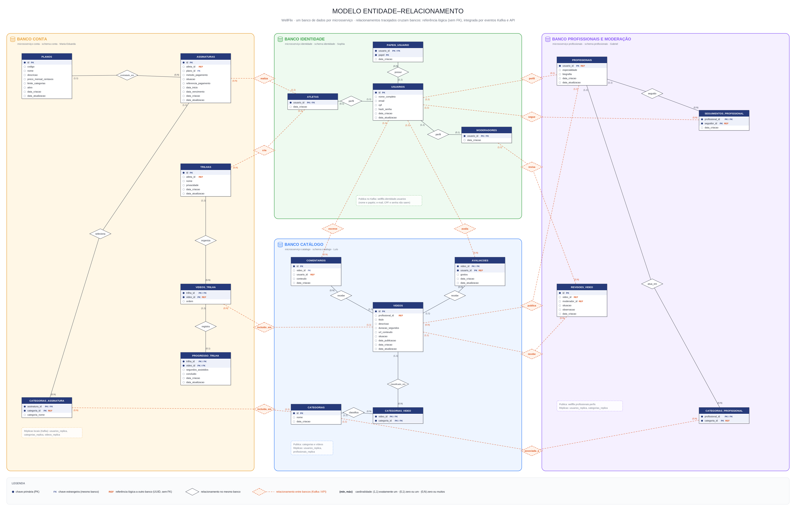

# Modelo de dados — Parte 3: vídeos e trilhas

**Apresentação:** Luís · **Tabelas:** TRILHAS, VIDEOS_TRILHA, PROGRESSO_TRILHA, CATEGORIAS_VIDEO, VIDEOS

## Ideia central

**VIDEOS** é o conteúdo da plataforma: cada vídeo é publicado por um profissional e passa por moderação antes de aparecer. O **atleta** monta **trilhas**, que são listas ordenadas de vídeos, e o sistema guarda o **progresso** dele em cada vídeo da trilha. **CATEGORIAS_VIDEO** classifica cada vídeo em uma ou mais categorias.

## Tabelas e chaves

| Tabela | Chave primária | Chave estrangeira / referência | Observações |
|---|---|---|---|
| VIDEOS | `id` | `profissional_id` → PROFISSIONAIS (referência lógica) | `situacao` ∈ {rascunho, aguardando_revisao, publicado, rejeitado, arquivado} |
| CATEGORIAS_VIDEO | `(video_id, categoria_id)` **composta** | `video_id` → VIDEOS · `categoria_id` → CATEGORIAS | associativa N:N |
| TRILHAS | `id` | `atleta_id` → ATLETAS (referência lógica) | `privacidade` ∈ {privada, publica} |
| VIDEOS_TRILHA | `(trilha_id, video_id)` **composta** | `trilha_id` → TRILHAS · `video_id` → VIDEOS (referência lógica) | `ordem` com `UNIQUE (trilha_id, ordem)` |
| PROGRESSO_TRILHA | `(trilha_id, video_id)` **composta** | `(trilha_id, video_id)` → VIDEOS_TRILHA (**FK composta**) | `segundos_assistidos`, `concluido` |

## Relacionamentos (frases para a apresentação)

1. **PROFISSIONAIS — VIDEOS (1 : N, "publica").** "Um profissional publica vários vídeos, e cada vídeo tem exatamente um autor, guardado em `profissional_id`."
2. **VIDEOS ⇄ CATEGORIAS (N : N), resolvido por CATEGORIAS_VIDEO.** "Um vídeo pode estar em várias categorias, e uma categoria tem vários vídeos. A chave primária composta impede repetir a mesma categoria no mesmo vídeo." Uma categoria em uso não pode ser apagada (`RESTRICT`).
3. **ATLETAS — TRILHAS (1 : N, "cria").** "Um atleta cria várias trilhas; cada trilha é de um atleta."
4. **TRILHAS ⇄ VIDEOS (N : N), resolvido por VIDEOS_TRILHA.** "Uma trilha tem vários vídeos, e um vídeo pode estar em várias trilhas. A associativa tem um **atributo próprio**, a `ordem`, e `UNIQUE (trilha_id, ordem)` impede dois vídeos na mesma posição."
5. **VIDEOS_TRILHA — PROGRESSO_TRILHA (1 : 0..1, "registra").** "Para cada vídeo de uma trilha existe no máximo um registro de progresso. A ligação é feita por uma **chave estrangeira composta** `(trilha_id, video_id)`, que é também a chave primária." Se o vídeo sai da trilha, o progresso é apagado junto (`CASCADE`).

**Ciclo de vida do vídeo:** `rascunho` ou `aguardando_revisao` → `publicado` ou `rejeitado` → `arquivado`. Só vídeos publicados aparecem no catálogo. Só vídeos ainda não publicados podem ser editados ou excluídos pelo profissional.

## Onde isso mora agora (banco por serviço)

| Tabela | Serviço (schema) |
|---|---|
| VIDEOS, CATEGORIAS_VIDEO | **catalogo** |
| TRILHAS, VIDEOS_TRILHA, PROGRESSO_TRILHA | **conta** |

Trilhas e vídeos estão em **serviços diferentes**, então `videos_trilha.video_id` não tem chave estrangeira. A integração é feita por eventos:

- **O catálogo publica as mudanças de vídeo.** Toda mudança vira um evento no tópico Kafka `wellflix.catalogo.videos`, com id, autor, título e situação.
- **A conta guarda uma réplica.** Ela mantém `videos_replica` e só aceita adicionar à trilha um vídeo que esteja `publicado` nessa réplica.
- **Por que isso basta.** Vídeo publicado não pode ser excluído (no máximo, é arquivado pelo moderador). Então nenhuma trilha fica apontando para um vídeo que não existe.
- **O nome do autor vem da identidade.** O catálogo mostra o nome do profissional pela própria `usuarios_replica`, também alimentada pelo Kafka.

## No código

| Rota | Serviço | O que faz |
|---|---|---|
| `GET /api/videos` | catalogo | Busca vídeos publicados (filtros por texto, categoria e avaliação mínima) com o nome do autor e as categorias. |
| `POST /api/videos` | catalogo | O profissional envia o vídeo; ele entra como `aguardando_revisao` só se as categorias forem autorizadas para ele. |
| `PUT` / `DELETE /api/videos/{id}` | catalogo | Edita (volta para a moderação) ou exclui um vídeo ainda não publicado. |
| `GET /api/videos/{id}/proximos` | catalogo | Sugere vídeos que compartilham categoria (via CATEGORIAS_VIDEO). |
| `POST /api/trilhas` | conta | Cria a trilha do atleta autenticado. |
| `POST /api/trilhas/{id}/videos` | conta | Adiciona um vídeo publicado na próxima `ordem`. |
| `PUT /api/trilhas/{id}/videos/{video}/progresso` | conta | Grava ou atualiza o progresso (*upsert*) do vídeo na trilha. |
| `GET /api/trilhas/publicas?q=` | conta | Busca trilhas públicas pelo nome da trilha ou do criador (pela `usuarios_replica`). |

## Perguntas prováveis

- **Por que a chave estrangeira do progresso é composta?** Porque o progresso é de um vídeo **dentro de uma trilha**, e esse par é identificado por `(trilha_id, video_id)`.
- **Por que a `ordem` fica na associativa e não no vídeo?** Porque o mesmo vídeo pode estar em posições diferentes em trilhas diferentes.
- **E se o catálogo estiver fora do ar?** A conta continua funcionando com a réplica. Quando o catálogo volta, os eventos pendentes chegam pelo Kafka.

