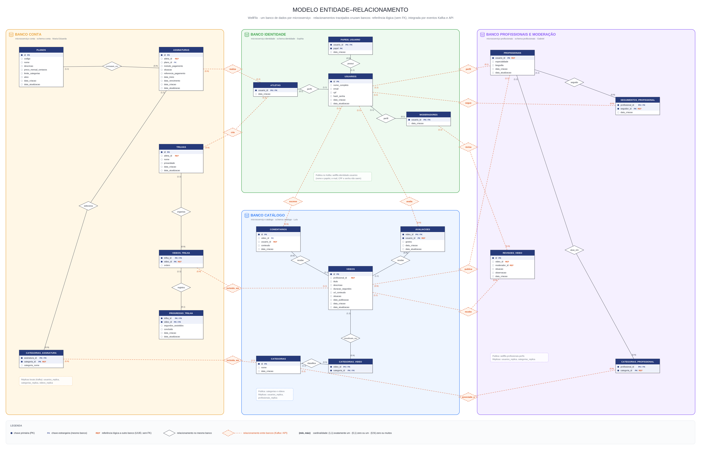

# Modelo de dados — Parte 4: interações e moderação

**Apresentação:** Gabriel · **Tabelas:** PROFISSIONAL_VIDEOS, REVISOES_VIDEO, AVALIACOES, COMENTARIOS, SEGUIMENTOS_PROFISSIONAL

## Ideia central

Esta parte registra **o que as pessoas fazem com o conteúdo**:

- o **moderador revisa** vídeos;
- o **usuário avalia** ("gostei" ou "não gostei") e **comenta** vídeos;
- o **usuário segue** profissionais.

Quase todas são tabelas que ligam duas entidades (vídeo e usuário, ou profissional e seguidor) e carregam informação própria.

## Tabelas e chaves

| Tabela | Chave primária | Chave estrangeira / referência | Observações |
|---|---|---|---|
| REVISOES_VIDEO | `id` | `video_id` → VIDEOS · `moderador_id` → MODERADORES (referências lógicas) | `situacao` ∈ {aprovado, rejeitado}, `observacao` |
| AVALIACOES | `(video_id, usuario_id)` **composta** | `video_id` → VIDEOS · `usuario_id` → USUARIOS (referência lógica) | `gostou` (boolean) |
| COMENTARIOS | `id` | `video_id` → VIDEOS · `usuario_id` → USUARIOS (referência lógica) | `conteudo` |
| SEGUIMENTOS_PROFISSIONAL | `(profissional_id, seguidor_id)` **composta** | `profissional_id` → PROFISSIONAIS · `seguidor_id` → USUARIOS (referência lógica) | `CHECK (profissional_id <> seguidor_id)` |
| PROFISSIONAL_VIDEOS | — | — | **removida no modelo novo** (ver abaixo) |

## Relacionamentos (frases para a apresentação)

1. **VIDEOS — REVISOES_VIDEO (1 : N, "recebe").** "Um vídeo pode receber várias revisões ao longo do tempo (por exemplo, rejeitado, corrigido e aprovado), e cada revisão é de um vídeo."
2. **MODERADORES — REVISOES_VIDEO (1 : N, "revisa").** "Um moderador faz várias revisões; cada revisão tem exatamente um moderador responsável."
3. **USUARIOS ⇄ VIDEOS por AVALIACOES (N : N com atributo).** "Um usuário avalia vários vídeos, e um vídeo recebe várias avaliações. A chave primária composta `(video_id, usuario_id)` garante **uma avaliação por pessoa por vídeo**: avaliar de novo só troca o `gostou`." A média de aprovação do vídeo é calculada a partir daqui.
4. **USUARIOS ⇄ VIDEOS por COMENTARIOS (N : N, "escreve").** "Diferente da avaliação, o comentário tem **id próprio**, porque a mesma pessoa pode comentar várias vezes no mesmo vídeo."
5. **USUARIOS ⇄ PROFISSIONAIS por SEGUIMENTOS_PROFISSIONAL (N : N, "segue").** "Um atleta segue vários profissionais, e um profissional tem vários seguidores. A chave primária composta impede seguir duas vezes, e o `CHECK` impede seguir a si mesmo."

Quando um vídeo é apagado, as avaliações e os comentários dele também são (`ON DELETE CASCADE`).

## O que estava errado no diagrama antigo

- **PROFISSIONAL_VIDEOS era redundante.** Ela ligava profissional e vídeo, mas essa informação já está em `videos.profissional_id` (um vídeo tem um único autor, relação 1:N). Nenhuma rota do sistema lia ou gravava essa tabela, então ela foi **removida** do modelo novo.
- **`revisoes_video.moderador_id` não batia com o código.** No diagrama apontava para MODERADORES, mas na migration apontava para USUARIOS e podia ficar vazio. No modelo novo é obrigatório e, conceitualmente, aponta para o moderador.

## Onde isso mora agora (banco por serviço)

| Tabela | Serviço (schema) |
|---|---|
| AVALIACOES, COMENTARIOS | **catalogo** (junto com os vídeos) |
| REVISOES_VIDEO, SEGUIMENTOS_PROFISSIONAL | **profissionais** (serviço de profissionais e moderação) |

Nenhuma dessas tabelas tem chave estrangeira para outro serviço. A integração funciona assim:

- **Moderar um vídeo** é um comando que precisa de resposta imediata, então usa **REST**. O serviço de profissionais grava a revisão e chama o catálogo (`POST /internal/videos/{id}/moderacao`). Se o catálogo recusar (por exemplo, o vídeo já foi revisado), a revisão é desfeita (*rollback*).
- **A publicação chega aos outros serviços por evento.** Quando o vídeo muda de situação, o catálogo publica no Kafka, e a conta passa a aceitar esse vídeo em trilhas.
- **Nomes de quem comentou, avaliou ou segue** vêm da `usuarios_replica`, alimentada pelo tópico `wellflix.identidade.usuarios`.
- **Estatísticas do profissional** (quantidade de vídeos e avaliação média) vêm da API do catálogo (`/internal/profissionais/estatisticas`).

## No código

| Rota | Serviço | O que faz |
|---|---|---|
| `GET /api/moderacao/videos` | profissionais | Fila de moderação (o catálogo fornece os vídeos pendentes). |
| `POST /api/moderacao/videos/{id}/decisao` | profissionais | Grava em REVISOES_VIDEO e publica ou rejeita o vídeo no catálogo. |
| `PUT /api/videos/{id}/avaliacao` | catalogo | Cria ou troca a avaliação (*upsert* pela PK composta). |
| `GET /api/videos/{id}/avaliacoes/resumo` | catalogo | Média e totais de "gostei" e "não gostei". |
| `POST /api/videos/{id}/comentarios` | catalogo | Comenta um vídeo publicado. |
| `POST` / `DELETE /api/profissionais/{id}/seguir` | profissionais | Segue ou deixa de seguir um profissional. |
| `GET /api/profissionais/me/seguindo` | profissionais | Profissionais que o atleta segue. |

## Perguntas prováveis

- **Por que avaliação tem chave composta e comentário tem id?** Porque cada pessoa pode avaliar um vídeo uma única vez, mas pode comentar quantas vezes quiser.
- **Por que guardar o histórico de revisões, e não só a situação do vídeo?** Para auditoria: saber quem aprovou ou rejeitou, quando e por quê.
- **Como a moderação muda um vídeo que é de outro serviço?** Pela API do catálogo, com um token de serviço. Ninguém escreve no banco dos outros.

