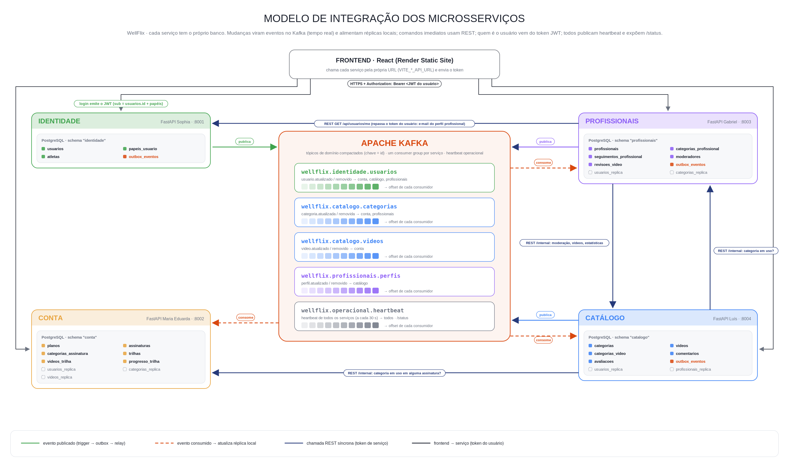

# Modelo arquitetônico de integração — WellFlix

**Base teórica:** capítulo 17, *Microservices Architecture*, de *Fundamentals of Software Architecture* (Mark Richards e Neal Ford).
**Hospedagem:** Render (frontend como Static Site e quatro Web Services FastAPI).
**Evidências:** logs da execução local em [`logs-integracao/`](./logs-integracao/).

## 1. Visão geral

O WellFlix tem quatro microsserviços, um por domínio (contexto delimitado):

| Serviço | Responsável | Domínio | Banco (schema próprio) |
|---|---|---|---|
| `identidade` | Sophia | contas, papéis, login (JWT), perfil de atleta | `identidade` |
| `conta` | Maria Eduarda | planos, assinaturas, trilhas e progresso | `conta` |
| `profissionais` | Gabriel | perfis profissionais, seguidores, moderadores e revisões | `profissionais` |
| `catalogo` | Luís | categorias, vídeos, comentários e avaliações | `catalogo` |

Eles se integram de três formas:

1. **Assíncrona, por eventos (coreografia):** cada mudança relevante vira um evento publicado no **Apache Kafka**. Os serviços interessados consomem e mantêm **réplicas locais** (`*_replica`).
2. **Síncrona, por REST:** usada só em comandos que precisam de resposta imediata e em consultas agregadas. As rotas ficam em `/internal/...` e exigem token de serviço.
3. **Token JWT:** a identidade emite o token, e os outros serviços sabem quem é o usuário sem consultar o banco dela.

Além disso, um componente operacional comum (o *sidecar*, seção 6) padroniza logs, correlação, heartbeat e `/status` nos quatro serviços.



## 2. Conceitos do capítulo 17 e como aparecem no WellFlix

| Conceito (cap. 17) | O que o livro diz | Implementação no WellFlix |
|---|---|---|
| **Contexto delimitado** | Cada serviço modela um domínio e inclui tudo de que precisa; prefere duplicação a acoplamento. | Um serviço por domínio. O nome do usuário é **duplicado** (réplica) em conta, catálogo e profissionais em vez de ser consultado na identidade. |
| **Isolamento de dados** | Nada de banco ou schema compartilhado como ponto de integração. Escolher uma fonte da verdade e distribuir por replicação ou cache. | Um schema por serviço; a conexão fixa o `search_path` no schema do próprio serviço. Não há FK entre bancos. Cada fato tem um dono (ex.: categorias são do catálogo), e os outros recebem cópias por evento. |
| **Distribuído** | Cada serviço roda no próprio processo. | Quatro Web Services independentes no Render, cada um com deploy, URL e `DATABASE_URL` próprios. |
| **Granularidade** | Evitar serviços pequenos demais, que exigem comunicação excessiva. | Quatro serviços de domínio, um por integrante. As operações que mudam juntas ficam no mesmo serviço (ex.: moderadores e revisões ficam em `profissionais`). |
| **Comunicação: protocolo conhecido** | Cada serviço sabe como chamar os outros (REST, mensageria...). | Padrão do projeto: **eventos Kafka** para propagar estado e **REST + JSON** (envelope `{"data": ...}`) para comandos. As URLs vêm de variáveis de ambiente (`*_API_URL`). |
| **Coreografia (broker EDA)** | Sem coordenador central: os serviços reagem a eventos. | Ninguém orquestra a publicação de um vídeo: o catálogo publica `video.atualizado`, e a conta reage atualizando `videos_replica`, que é o que libera o vídeo para entrar em trilhas. |
| **Orquestração localizada** | Quando é preciso coordenar, cria-se um mediador local. | A **moderação** é um pequeno mediador: `profissionais` grava a revisão e chama o catálogo por REST. |
| **Transações e sagas** | Evitar transações distribuídas; quando inevitáveis, usar saga com compensação. | Não há transação distribuída. Na moderação, se o catálogo recusar, a transação local de `profissionais` é desfeita (compensação). A gravação do dado e do evento é atômica graças ao **transactional outbox** (o evento é gravado na mesma transação do dado). |
| **Reuso operacional / sidecar / service mesh** | Logs, monitoramento e afins são compartilhados por um componente comum, sem acoplar domínios. | `backend/services/shared/observabilidade.py`: logs padronizados, `X-Request-ID` propagado entre serviços e eventos, heartbeat pelo broker e `/status` (seção 6). |
| **API layer** | Opcional; não deve virar mediador de regras. | Não há gateway: o frontend chama cada serviço pela própria URL (`VITE_*_API_URL`). A descoberta de serviços é feita por variáveis de ambiente. É uma decisão consciente para o plano gratuito do Render, e um gateway poderia ser incluído depois sem mudar os serviços. |
| **Frontend** | Frontend monolítico ou microfrontends. | **Frontend monolítico** (React/Vite) que chama os quatro serviços. |

## 3. Comunicação assíncrona: eventos

### Por que Kafka (e não RabbitMQ)

As duas ferramentas citadas são brokers de mensagens, com papéis diferentes:

| | **Apache Kafka** (escolhido) | **RabbitMQ** |
|---|---|---|
| Modelo | **Log** particionado e persistente; cada consumidor guarda o próprio *offset*. | **Filas**; a mensagem sai da fila quando é confirmada. |
| Reprocessamento | Um serviço novo (ou uma réplica apagada) pode reler o tópico desde o início. | Mensagens já consumidas não voltam. |
| Estado mais recente | Tópicos **compactados** guardam o último evento de cada chave (id da entidade). | Não tem equivalente nativo. |
| Melhor para | Propagar **estado** entre bancos (réplicas) e o histórico de eventos. | Distribuir **tarefas e comandos** com roteamento flexível. |

O uso principal no WellFlix é manter réplicas sincronizadas com o dono do dado. Por isso o Kafka com tópicos compactados se encaixa melhor: a réplica pode ser reconstruída a qualquer momento relendo o tópico.

### Fluxo de um evento (transactional outbox)

```text
serviço dono                                broker                     serviço interessado
──────────────────────────────────────      ──────────────             ─────────────────────────────
UPDATE/INSERT no dado ─┐                                                
trigger grava o evento ├─ mesma transação                               
em outbox_eventos     ─┘                                                
pg_notify('outbox') ─► relay publica ───►  tópico Kafka  ───► consumidor (consumer group próprio)
                       marca publicado_em  (compactado)       upsert na *_replica + commit do offset
```

- **Atomicidade sem transação distribuída:** o evento só existe se o dado foi gravado.
- **Entrega "pelo menos uma vez":** o offset só é confirmado depois que a réplica é gravada. As gravações são idempotentes (upsert do estado completo).
- **Broker fora do ar:** os eventos se acumulam no outbox e são publicados quando ele volta.

| Tópico | Produtor | Consumidores | Réplica atualizada |
|---|---|---|---|
| `wellflix.identidade.usuarios` | identidade | conta, catálogo, profissionais | `usuarios_replica` (nome e papéis) |
| `wellflix.catalogo.categorias` | catálogo | conta, profissionais | `categorias_replica` |
| `wellflix.catalogo.videos` | catálogo | conta | `videos_replica` |
| `wellflix.profissionais.perfis` | profissionais | catálogo | `profissionais_replica` (categorias autorizadas) |
| `wellflix.operacional.heartbeat` | todos | todos | estado em memória (`/status`) |

E-mail, CPF e senha **nunca** saem do serviço de identidade em eventos.

## 4. Comunicação síncrona: REST

| Quem chama | Quem responde | Rota | Para quê |
|---|---|---|---|
| profissionais | catálogo | `GET /internal/videos?situacao=` | fila de moderação |
| profissionais | catálogo | `POST /internal/videos/{id}/moderacao` | publicar/rejeitar (com compensação local se falhar) |
| profissionais | catálogo | `POST /internal/videos/{id}/arquivamento` | arquivar vídeo |
| profissionais | catálogo | `GET /internal/profissionais/estatisticas`, `/{id}/videos` | dados agregados do perfil |
| profissionais | identidade | `GET /api/usuarios/me` (token do usuário) | e-mail do perfil profissional |
| catálogo | profissionais, conta | `GET /internal/categorias/{id}/uso` | impedir excluir categoria em uso |

As rotas `/internal` aceitam apenas **token de serviço**: um JWT de curta duração com audiência `wellflix-internal`, assinado com o segredo comum. Toda chamada leva os cabeçalhos `X-Request-ID` e `X-Servico-Origem`.

## 5. Ciclo de vida de um serviço

Ao iniciar, cada serviço faz o seguinte, por conta própria e sem depender dos outros:

1. **Aplica as próprias migrations** no próprio schema (`MIGRAR_AO_INICIAR`, ligado por padrão). Um *advisory lock* impede duas instâncias de migrarem juntas. Assim o banco acompanha a versão do código a cada deploy no Render.
2. Conecta ao broker e cria os tópicos que faltarem.
3. Inicia as threads de **relay do outbox** (se produz eventos), **consumidor** (se tem réplicas), **envio de heartbeat** e **escuta de heartbeat**.

## 6. Reuso operacional (o *sidecar* do WellFlix)

O módulo `backend/services/shared/observabilidade.py` é igual nos quatro serviços e não conhece nenhum domínio:

- **Logs padronizados:** `data hora | serviço | nível | componente | [req=id] mensagem`. Os componentes são `http`, `rest`, `eventos`, `heartbeat` e `migracao`.
- **Correlação:** o `X-Request-ID` da requisição (gerado ou recebido) segue nas chamadas REST, entra na sessão do PostgreSQL (`wellflix.correlacao`), é gravado na coluna `outbox_eventos.correlacao` e viaja no evento Kafka. Com ele, uma única ação aparece nos logs de todos os serviços que ela atravessa.
- **Heartbeat pelo broker:** a cada `HEARTBEAT_INTERVALO_SEGUNDOS` (padrão 30), cada serviço publica em `wellflix.operacional.heartbeat` quem é, o número da batida e quantos eventos tem pendentes no outbox. Cada serviço escuta os outros e registra o atraso.
- **`GET /status`:** devolve banco (incluindo eventos pendentes no outbox), broker (configurado e conectado), eventos publicados e consumidos (por origem), chamadas REST e o último heartbeat de cada outro serviço. O `/health` continua simples, para o health check do Render.

## 7. Evidências: execução local

### Como reproduzir

```bash
pip install -r backend/services/identidade/requirements.txt   # as quatro listas são iguais
scripts/rodar_local.sh            # Docker (PostgreSQL + Kafka), migrations + seed, 4 serviços com logs em logs/
python scripts/demo_integracao.py # fluxo que atravessa os quatro serviços
tail -f logs/*.log                # publicação, consumo, REST e heartbeats ao vivo
curl localhost:8003/status        # estado operacional (portas 8001 a 8004)
scripts/parar_local.sh
```

### O fluxo demonstrado

O script [`scripts/demo_integracao.py`](../../scripts/demo_integracao.py) usa só as APIs públicas. Cada passo **depende de um evento ou chamada entre serviços**, então ele falha se a integração não funcionar:

| Passo | Ação | Integração que precisa funcionar |
|---|---|---|
| 1 | Atleta se cadastra (identidade) | `usuario.atualizado` → réplicas em conta, catálogo e profissionais |
| 2 | Moderador cria categoria (catálogo) | `categoria.atualizada` → réplicas em conta e profissionais |
| 3 | Profissional se autoriza na categoria (profissionais) | réplica de categorias; REST para a identidade; `perfil.atualizado` → catálogo |
| 4 | Profissional envia vídeo nessa categoria (catálogo) | réplica do perfil profissional no catálogo |
| 5 | Moderador vê a fila e aprova (profissionais) | REST profissionais → catálogo; `video.atualizado` → conta |
| 6 | Atleta põe o vídeo numa trilha (conta) | réplica de vídeos publicados na conta |
| 7 | `/status` dos quatro serviços | heartbeats recebidos dos outros três |

Resultado ([`demo_integracao.txt`](./logs-integracao/demo_integracao.txt)): os 7 passos foram concluídos. Na execução registrada houve 62 eventos publicados, 105 consumidos, 128 linhas de heartbeat e nenhum erro nos logs.

### Trechos dos logs ([`todos_em_ordem.log`](./logs-integracao/todos_em_ordem.log))

**Um cadastro na identidade se espalhando para os três outros serviços** (mesmo `req`):

```text
16:12:29.315 | identidade    | http      | [req=demo-1-f10aab] POST /api/atletas -> 201 em 671 ms
16:12:29.533 | identidade    | eventos   | [req=demo-1-f10aab] PUBLICADO usuario.atualizado -> wellflix.identidade.usuarios (chave=5956d73d-…, id_evento=17)
16:12:29.804 | catalogo      | eventos   | [req=demo-1-f10aab] CONSUMIDO usuario.atualizado de identidade (…, id_evento=17, 486 ms após a publicação) -> upsert_usuario
16:12:30.143 | conta         | eventos   | [req=demo-1-f10aab] CONSUMIDO usuario.atualizado de identidade (…, id_evento=17, 826 ms após a publicação) -> upsert_usuario
16:12:30.144 | profissionais | eventos   | [req=demo-1-f10aab] CONSUMIDO usuario.atualizado de identidade (…, id_evento=17, 826 ms após a publicação) -> upsert_usuario
```

**Categoria criada no catálogo chegando a conta e profissionais em menos de 60 ms:**

```text
16:12:37.239 | catalogo      | http      | [req=demo-2-d2b851] POST /api/categorias -> 201
16:12:37.269 | catalogo      | eventos   | [req=demo-2-d2b851] PUBLICADO categoria.atualizada -> wellflix.catalogo.categorias (id_evento=28)
16:12:37.296 | profissionais | eventos   | [req=demo-2-d2b851] CONSUMIDO categoria.atualizada de catalogo (…, 44 ms após a publicação) -> upsert_categoria
16:12:37.308 | conta         | eventos   | [req=demo-2-d2b851] CONSUMIDO categoria.atualizada de catalogo (…, 56 ms após a publicação) -> upsert_categoria
```

**Moderação: REST síncrono seguido de evento assíncrono, na mesma correlação:**

```text
profissionais | rest    | [req=demo-5-0379b5] REST profissionais -> catalogo GET /internal/videos -> 200
catalogo      | http    | [req=demo-5-0379b5] POST /internal/videos/3ccf31ed-…/moderacao -> 200 (chamado por profissionais)
profissionais | rest    | [req=demo-5-0379b5] REST profissionais -> catalogo POST /internal/videos/3ccf31ed-…/moderacao -> 200
catalogo      | eventos | [req=demo-5-0379b5] PUBLICADO video.atualizado -> wellflix.catalogo.videos (id_evento=30)
conta         | eventos | [req=demo-5-0379b5] CONSUMIDO video.atualizado de catalogo (wellflix.catalogo.videos, id_evento=30) -> upsert_video
```

**Heartbeat pelo broker** (cada serviço vê os outros três):

```text
16:12:59.782 | conta | heartbeat | HEARTBEAT recebido de profissionais #6 (atraso 5729 ms, outbox pendentes: 0)
16:12:59.806 | conta | heartbeat | HEARTBEAT recebido de catalogo #6 (atraso 5734 ms, outbox pendentes: 0)
16:12:59.807 | conta | heartbeat | HEARTBEAT recebido de identidade #6 (atraso 5775 ms, outbox pendentes: 0)
16:12:59.889 | conta | heartbeat | HEARTBEAT enviado #6 -> wellflix.operacional.heartbeat (outbox pendentes: None)
```

O estado final de cada serviço está em [`status_apos_demo.json`](./logs-integracao/status_apos_demo.json).

**Observação sobre os tempos:** a execução foi feita no WSL2, com 3,7 GB de memória e swap cheio. Algumas requisições demoraram alguns segundos (hash de senha com scrypt sob paginação), e o relógio do WSL foi corrigido pelo `systemd-timesyncd` durante a execução: há saltos de cerca de 2 s para trás. Por isso alguns atrasos aparecem grandes ou até negativos, e a ordem das linhas em `todos_em_ordem.log` pode trocar perto desses saltos. A correlação pelo `req=` não depende do relógio.

## 8. Publicação no Render

### Verificação feita em 13/11/2026 (somente leitura: `GET /health` e rotas públicas)

| Componente | URL | `/health` | Rotas que usam o banco |
|---|---|---|---|
| Frontend | https://wellflix-frontend.onrender.com | 200 | — (aponta para as 4 URLs abaixo) |
| identidade | https://wellflix-identidade-sophia.onrender.com | 200 | `POST /api/auth/sessao` → **500** |
| conta | https://wellflix-conta-maria.onrender.com | 200 | `GET /api/planos` → **500** |
| profissionais | https://wellflix-profissionais-moderadores.onrender.com | 200 | `GET /api/profissionais` → **500** |
| catálogo | https://wellflix-catalogo-luis.onrender.com | 200 | `GET /api/categorias`, `GET /api/videos` → **500** |

O código publicado já é o da separação por schemas (as rotas `/internal` novas aparecem no `/openapi.json`). O erro 500 em toda rota que acessa o banco indica que **as migrations por serviço não foram aplicadas** no PostgreSQL usado pelo Render: os schemas `identidade`, `conta`, `profissionais` e `catalogo` não existem ou estão vazios.

### O que foi alterado para corrigir

- Cada serviço agora **aplica as próprias migrations ao iniciar**. O próximo deploy de cada Web Service cria e atualiza o schema dele, sem passo manual.

### O que precisa ser configurado no painel do Render

1. **Fazer o deploy** dos quatro serviços com este código. Em seguida, conferir `/status` de cada um: `banco.ok` deve ser `true`.
2. **Broker de mensagens:** o Render não oferece Kafka. Para os eventos funcionarem em produção, criar um Kafka gerenciado (ex.: Confluent Cloud ou Aiven) e configurar nos quatro serviços `KAFKA_BOOTSTRAP_SERVERS`, `KAFKA_SECURITY_PROTOCOL=SASL_SSL`, `KAFKA_SASL_MECHANISM`, `KAFKA_SASL_USERNAME`, `KAFKA_SASL_PASSWORD` e `KAFKA_TOPIC_REPLICATION=3`. Sem isso, os serviços sobem, mas os eventos ficam no outbox e as réplicas não se atualizam. O `/status` mostra `broker.configurado: false`.
3. **URLs entre serviços:** em `profissionais`, `IDENTIDADE_API_URL` e `CATALOGO_API_URL`; em `catalogo`, `PROFISSIONAIS_API_URL` e `CONTA_API_URL`, com as URLs públicas da tabela acima.
4. **Mesmo `AUTH_TOKEN_SECRET`** nos quatro serviços, usado pelos tokens de usuário e de serviço.
5. **Plano gratuito:** um serviço sem tráfego HTTP "dorme" depois de cerca de 15 minutos. Enquanto dorme, ele não publica heartbeat nem consome eventos. Ao acordar, o consumidor retoma do último offset confirmado, e nada se perde.

Depois de configurado, `GET /status` em cada URL mostra os heartbeats recebidos dos outros serviços, que é a evidência de comunicação pelo broker também em produção.

## 9. Limitações e próximos passos

- **Consistência eventual:** uma réplica pode ficar alguns milissegundos (ou, com o serviço dormindo no Render, alguns minutos) atrás do dono do dado.
- **Eventos por linha:** salvar um perfil com várias categorias gera um evento por linha alterada. Funciona porque o consumidor é idempotente, mas um evento por transação seria mais econômico.
- **Sem API gateway:** autenticação e CORS são verificados em cada serviço. Um gateway poderia centralizar isso, mas sem regra de negócio, como recomenda o livro.
- **Sem service mesh real:** o "sidecar" é uma biblioteca comum, não um processo separado. Em produção, ferramentas de observabilidade (OpenTelemetry, por exemplo) poderiam substituir o `/status` e os logs de texto.
